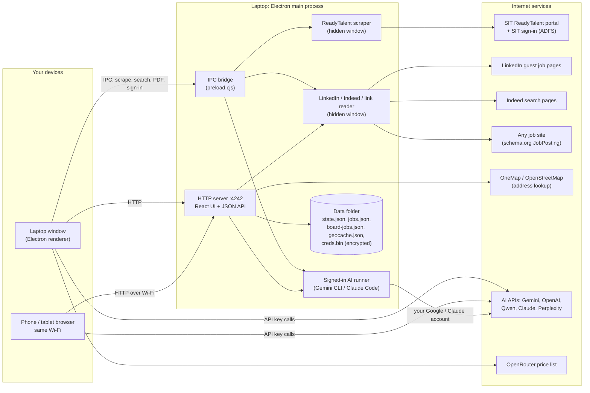
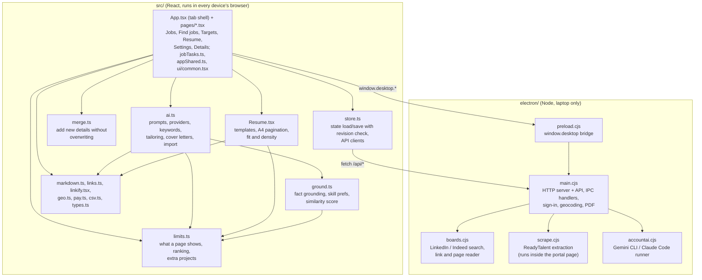
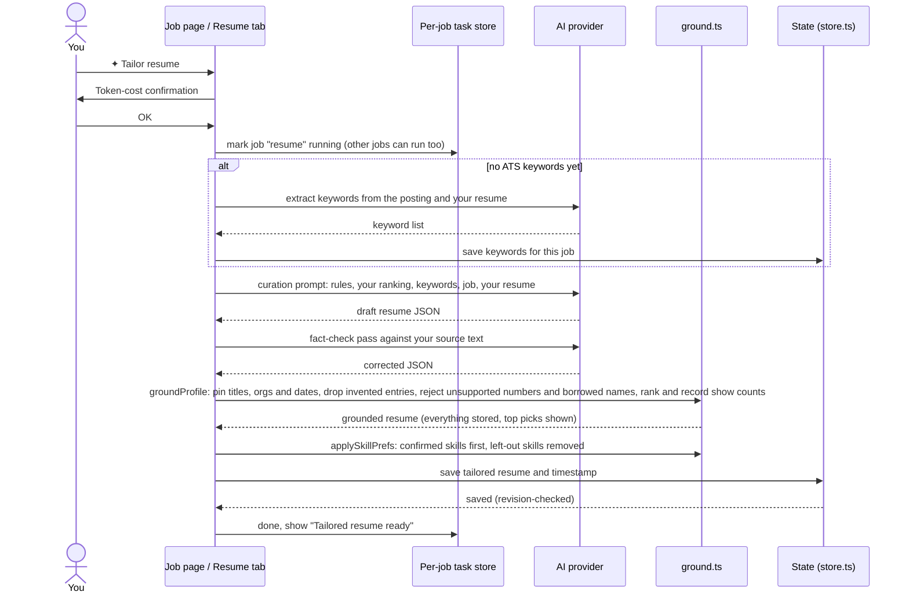
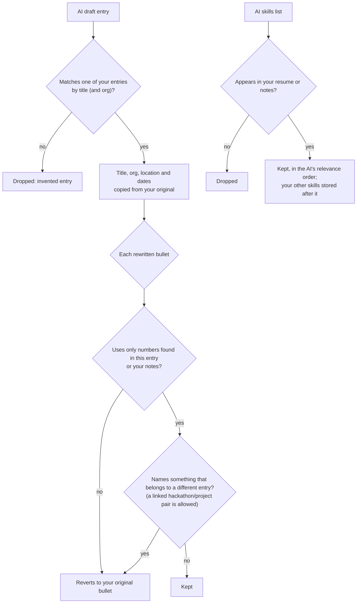
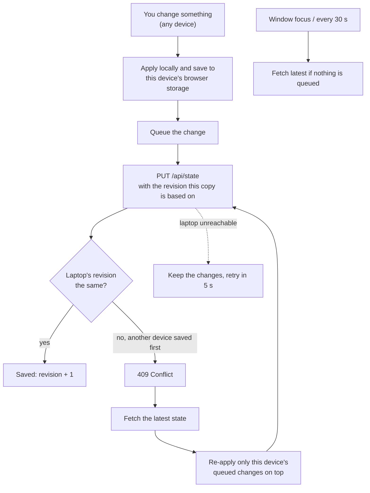
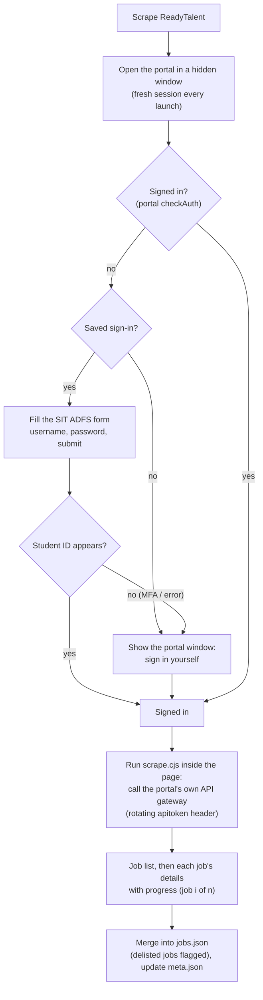
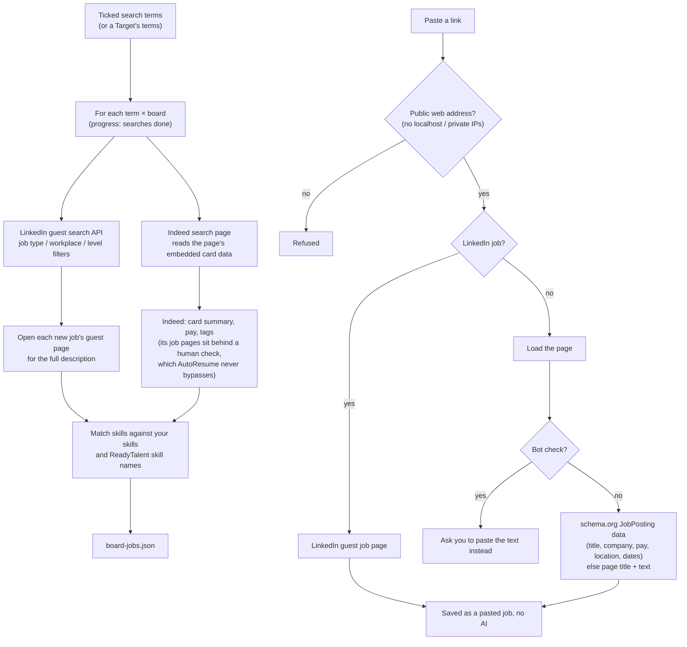
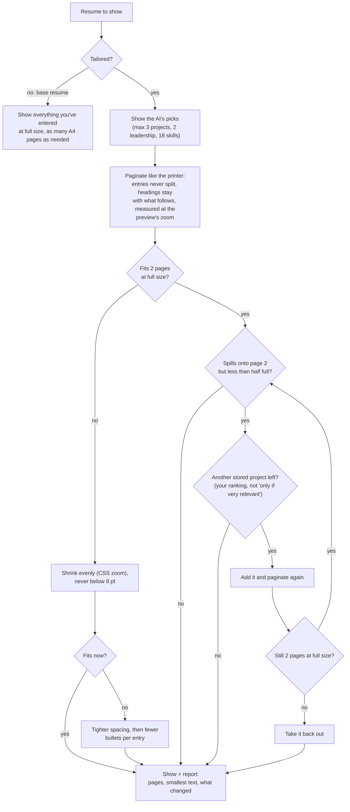
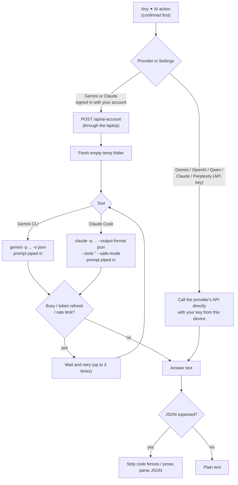
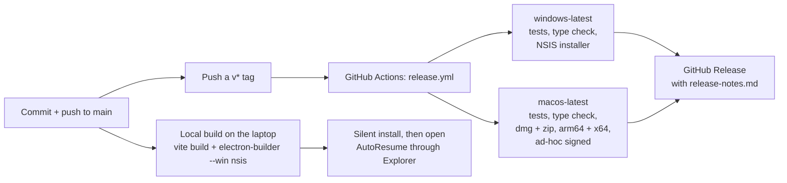

# AutoResume architecture

How AutoResume is put together, how data moves through it, and the logic behind its main features. The diagrams are [Mermaid](https://mermaid.js.org/), which GitHub renders directly.

- [System overview](#system-overview)
- [Code map](#code-map)
- [Data and where it lives](#data-and-where-it-lives)
- [Flow: tailoring a resume](#flow-tailoring-a-resume)
- [Flow: saving changes from several devices](#flow-saving-changes-from-several-devices)
- [Flow: scraping ReadyTalent](#flow-scraping-readytalent)
- [Flow: LinkedIn and Indeed search, pasted links](#flow-linkedin-and-indeed-search-pasted-links)
- [Flow: fitting a resume onto A4 pages](#flow-fitting-a-resume-onto-a4-pages)
- [Flow: AI with an API key or your own account](#flow-ai-with-an-api-key-or-your-own-account)
- [Flow: building and releasing](#flow-building-and-releasing)
- [Tests](#tests)

## System overview

AutoResume is an Electron desktop app. Its main process runs a small HTTP server on port 4242, which serves the React interface and a JSON API. The desktop window, phones and tablets on the same Wi-Fi all use the same interface and API. Scraping and the signed-in AI tools run only on the laptop. API-key AI calls go straight from whichever device you're on to the AI provider.

## Code map

## Data and where it lives

| File (laptop data folder) | What's in it | Written by |
|---|---|---|
| `state.json` | Your details, settings, saved/applied/rejected/not-hiring flags, tailored resumes, cover letters, keywords, search terms, targets, filters, and a revision number `_rev` | `PUT /api/state`, revision-checked |
| `jobs.json` | ReadyTalent postings | ReadyTalent scrape |
| `board-jobs.json` | LinkedIn / Indeed results | Search, Clear results |
| `geocache.json` | Address → coordinates lookups | Distance filter |
| `creds.bin` | ReadyTalent sign-in, encrypted with Windows DPAPI or the macOS Keychain | Settings → ReadyTalent sign-in |
| `meta.json` | The portal's employment-type and programme lists | ReadyTalent scrape |

The data folder is `%APPDATA%\autoresume` on Windows and the app's folder under `~/Library/Application Support/` on a Mac. Every device also keeps a copy of `state` in its browser storage so it keeps working if the laptop is briefly unreachable.

## Flow: tailoring a resume

The AI only rewords and selects; everything it writes is checked against your own resume text and notes before it's kept.

What the grounding step guarantees:

## Flow: saving changes from several devices

The laptop window, a phone and a tablet can all edit at once without overwriting each other.

## Flow: scraping ReadyTalent

## Flow: LinkedIn and Indeed search, pasted links

## Flow: fitting a resume onto A4 pages

Printing uses the same layout: **Save PDF** prints one document at a time (resume or cover letter) on A4 with the page margins repeated on every page.

## Flow: AI with an API key or your own account

## Flow: building and releasing

## Tests

`pnpm test` runs dependency-free self-checks with Node:

| Test | Covers |
|---|---|
| `test/boards.test.cjs` | Search filters, skill matching, Indeed hosts, pasted-link parsing (JSON-LD, pay, LinkedIn ids, blocked addresses) |
| `test/ground.test.ts` | Fact grounding, skill preferences, ranking and show counts, base vs tailored views, filling page 2, hackathon/project linking, similarity score |
| `test/merge.test.ts` | Adding new details without overwriting, reworded and combined bullets |
| `test/markdown.test.ts` | The .md resume template round trip |
| `test/pay.test.ts` | Monthly pay from any salary text |
| `test/linkify.test.ts` | Clickable links in PDFs |
| `test/geo.test.ts` | Distances and place queries |
| `test/csv.test.ts` | Spreadsheet export escaping |
| `electron/scrape.test.cjs` | ReadyTalent extraction on a mocked portal |

CI also runs `tsc --noEmit` before building.
